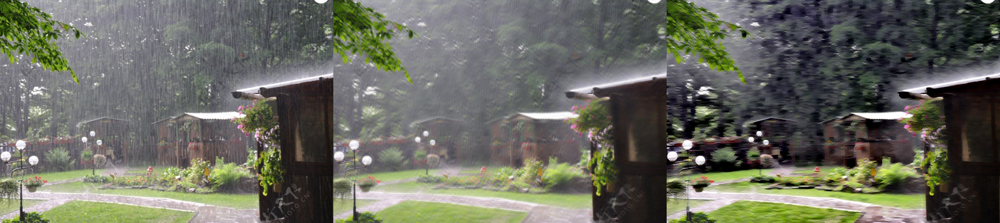
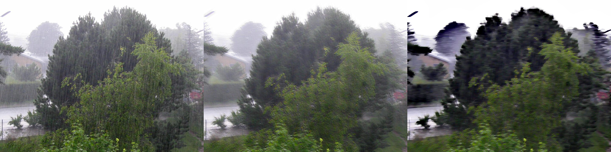
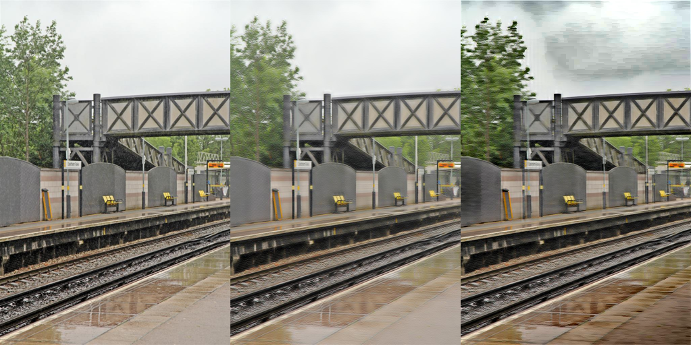

# 单幅图像去雨

雨不止留下细丝。雨滴把光散射开，远处会叠上一层亮幕，场景里较宽的明暗被压低。细丝、亮幕和被压低的细节来自同一次降雨，所以放在一个目标里一起估计。

优化目标是五项之和：重建、雨的方向子空间、雨的宽度、背景的特征似然、散射。

$$
\min_{B,R,t}\ \|O-Bt-R-A(1-t)\|_F^2
+\sum_{s\in\{8,16,32\}}\sum_i\Big(
w_{s,i}\|(I-P_{s,\theta})R_i\|_F^2
+(1-w_{s,i})\|P_{s,\theta}R_i\|_F^2
\Big)
+\beta\|M_9 S_\theta R\|_F^2
+\gamma\Phi(B)
+\eta\|D_{12}(O-R-A(1-t))-t\,D_{12}B\|_F^2.
$$

各项的含义：

- 第一项是重建。透射后的背景、雨丝、散射进来的光，三者相加回到观测。
- 第二项是雨的方向结构。雨丝活在沿 $\theta$ 不变的子空间里；横向上不反复起伏的块不记成雨丝。
- 第三项是雨的宽度。对齐到竖直以后，宽结构不是雨丝。
- 第四项是背景的特征似然。背景块应像自然图像。
- 第五项是散射。观测里的宽细节是背景宽细节乘上 $t$ 之后的结果；$t$ 越小，背景里的这份细节就要越大。细雨丝不跟着被放大。

## 重建

$O$ 是观测的亮度，$B$ 是背景，$R$ 是雨丝。$t$ 是透射率，距离越远 $t$ 越小。$A$ 是散射光的亮度。成像是

$$
O = Bt + R + A(1-t).
$$

$Bt$ 是穿过雨幕还保留下来的背景，$A(1-t)$ 是散进镜头的那一层光。$\|\cdot\|_F^2$ 是各像素误差的平方和。这一项只要求三部分能加回观测，还不判断一块像素该归到哪一部分。

## 方向子空间

先把方向 $\theta$ 定在最平坦、仍有雨的窗口上：沿该方向不变的成分若占能量多，且垂直于该方向的剖面至少变号两次，这个方向就更像雨。

$P_{s,\theta}$ 把边长为 $s$ 的图像块投到「沿 $\theta$ 不变」的子空间。$s$ 取 8、16、32，长雨丝和稍宽的雨丝都落进这个子空间。$R_i$ 是雨层上的第 $i$ 块。

$w_{s,i}=1$ 时，这块在垂直于雨的方向上至少变号两次，并且子空间占了足够能量。此时惩罚 $(I-P_{s,\theta})R_i$，雨只能留在子空间内。$w_{s,i}=0$ 时，反过来惩罚 $P_{s,\theta}R_i$，这块不从背景里扣除。

## 宽度

$S_\theta$ 把图像沿 $\theta$ 剪切，使雨丝变成竖直。$M_9$ 是宽为 9 的横向中值。中值跟得上比大约 4 像素更宽的结构，跟不上窄雨丝。$\|M_9 S_\theta R\|_F^2$ 把宽的那一部分赶出雨层，还回背景。与雨平行的屋檐、叶面因此留在 $B$ 里。

## 背景似然

$\Phi(B)=-\sum_i \log G(P_i B)$。$G$ 是在自然图像上估计的高斯混合，块去均值，均值是 0。一块背景的似然高，表示它落在混合的某一分量附近。程序里对残差做一次该混合的维纳滤波，把像自然图像的细节加回 $B$。

## 散射

雨滴把光线散开。近处 $t$ 接近 1，亮幕 $A(1-t)$ 很薄；远处 $t$ 下降，亮幕变厚，背景里较宽的明暗被乘上一个更小的 $t$。$D_{12}$ 取出大约 12 像素宽的细节。第五项要求这份细节先乘 $t$，再和观测里去掉雨丝与亮幕之后的宽细节一致。$t$ 越小，$D_{12}B$ 就必须越大，被散射压低的明暗才回到背景。

拉回来的增量里如果还有沿 $\theta$ 的细丝，仍留在 $R$。恢复出来的像素也不抬得高于 $O-R$，避免边缘被散射项拉出一条亮边。$t$ 看观测本身：一块邻域里如果已经没有暗像素，说明散射光把暗部填上了，这里的 $t$ 就小。

## 实验

每张图从左到右是原图、文章复现、当前方法。文章复现是 Li 等 CVPR 2016 的层先验，只做背景加雨丝。当前方法是上面的五项一起估计。

### 院子



### 树



### 雨伞


### 车站



### 树叶


## 启动

Python 3，需要 `numpy`、`scipy`、`scikit-learn`、`pillow`。背景混合的权重在 `gsmodel_8x8_200.npz`。

在本目录执行。下面这条是文章复现，默认读 `LPDerain-main/case1.jpg`，边长缩为一半，结果写在当前目录：

```text
python run_lp.py
```

当前方法：

```text
python run_lp.py --method current --input 图片路径 --output 输出目录
```

输出三份：`derained.png` 是彩色结果，`rain.png` 是雨层（显示时加了 0.5），`compare.png` 是原图和结果左右并排。只处理亮度，色度用原图的 Cb、Cr。
