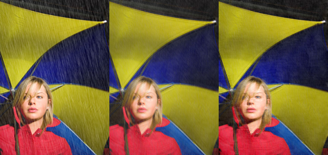
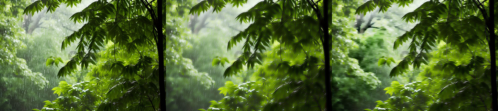

# 单幅图像去雨

观测分成背景和雨。优化目标是四项之和：重建、雨的方向子空间、雨的宽度、背景的特征似然。

\[
\min_{B,R}\ \|O-B-R\|_F^2
+\sum_{s\in\{8,16,32\}}\sum_i\Big(
w_{s,i}\|(I-P_{s,\theta})R_i\|_F^2
+(1-w_{s,i})\|P_{s,\theta}R_i\|_F^2
\Big)
+\beta\|M_9 S_\theta R\|_F^2
+\gamma\Phi(B).
\]

各项的含义：

- 第一项是重建。背景与雨相加应回到观测。
- 第二项是雨的方向结构。雨活在沿 \(\theta\) 不变的子空间里；横向上不反复起伏的块不记成雨。
- 第三项是雨的宽度。对齐到竖直以后，宽结构不是雨。
- 第四项是背景的特征似然。背景块应像自然图像。

## 重建

\(O\) 是观测的亮度，\(B\) 是背景，\(R\) 是雨，\(O \approx B+R\)。\(\|\cdot\|_F\) 是把每个像素的误差平方后相加再开方，这里写成平方和。这一项只要求两层能加回观测，不判断一块是雨还是背景。

## 方向子空间

先把方向 \(\theta\) 定在最平坦、仍有雨的窗口上：沿该方向不变的成分若占能量多，且垂直于该方向的剖面至少变号两次，这个方向就更像雨。

\(P_{s,\theta}\) 把边长为 \(s\) 的图像块投到「沿 \(\theta\) 不变」的子空间。\(s\) 取 8、16、32，长雨丝和稍宽的雨丝都落进这个子空间。\(R_i\) 是雨层上的第 \(i\) 块。

\(w_{s,i}=1\) 时，这块在垂直于雨的方向上至少变号两次，并且子空间占了足够能量。此时惩罚 \((I-P_{s,\theta})R_i\)，雨只能留在子空间内。\(w_{s,i}=0\) 时，反过来惩罚 \(P_{s,\theta}R_i\)，这块不从背景里扣除。

## 宽度

\(S_\theta\) 把图像沿 \(\theta\) 剪切，使雨丝变成竖直。\(M_9\) 是宽为 9 的横向中值。中值跟得上比大约 4 像素更宽的结构，跟不上窄雨丝。\(\|M_9 S_\theta R\|_F^2\) 把宽的那一部分赶出雨层，还回背景。与雨平行的屋檐、叶面因此留在 \(B\) 里。

## 背景似然

\(\Phi(B)=-\sum_i \log G(P_i B)\)。\(G\) 是在自然图像上估计的高斯混合，块去均值，均值是 0。一块背景的似然高，表示它落在混合的某一分量附近。程序里对残差做一次该混合的维纳滤波，把像自然图像的细节加回 \(B\)。

## 雾

\(B,R\) 分开之后，剩下的灰用透射率写：

\[
O-R = Bt + A(1-t).
\]

\(t\) 由原图的暗通道给出，\(A\) 是大气光。\(t\) 小，表示这一带更远、雾更厚。恢复时不把像素提得比 \(O-R\) 更亮。\(t\) 小的地方，再加强背景里较宽的细节；这次加强里的细雨丝退回雨层。

## 实验

每张图从左到右是原图、文章复现、当前方法。文章复现是 Li 等 CVPR 2016 的层先验。当前方法是上面的目标，再加上雾。

### 院子


### 树


### 雨伞



### 车站


### 树叶



## 启动

Python 3，需要 `numpy`、`scipy`、`scikit-learn`、`pillow`。背景混合的权重在 `gsmodel_8x8_200.npz`。

在本目录执行。下面这条是文章复现，默认读 `LPDerain-main/case1.jpg`，边长缩为一半，结果写在当前目录：

```text
python run_lp.py
```

当前方法：

```text
python run_lp.py --method current --input 图片路径 --output 输出目录
```

输出三份：`derained.png` 是彩色结果，`rain.png` 是雨层（显示时加了 0.5），`compare.png` 是原图和结果左右并排。只处理亮度，色度用原图的 Cb、Cr。
